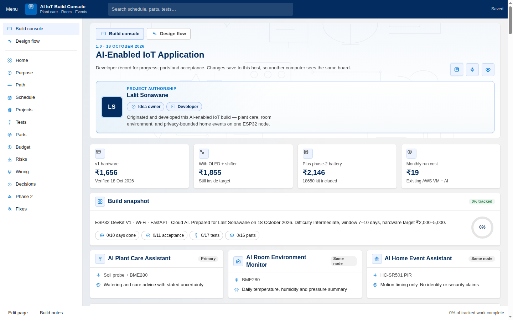
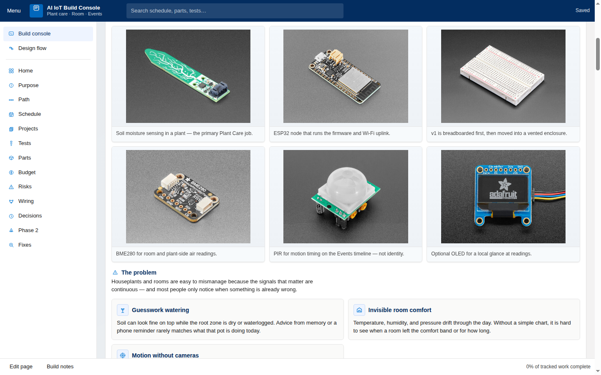
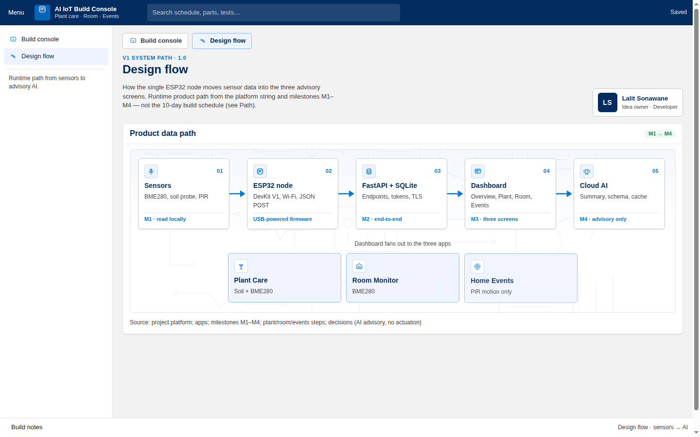
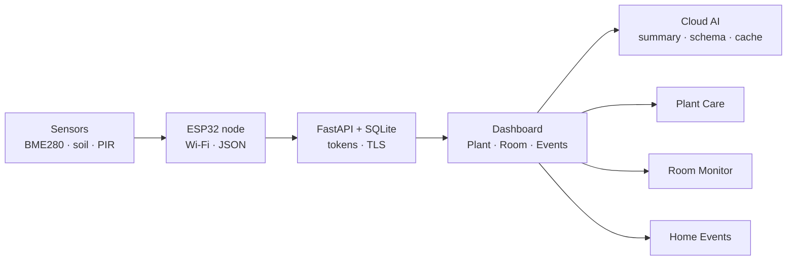
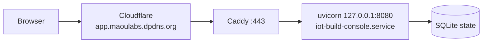

# AI IoT Build Console

Shared **build tracker** for the v1 ESP32 hardware project — Plant Care, Room Environment, and Home Events on one node. It records the 10-day plan, acceptance checks, T1–T17 tests, BOM, budget, risks, and wiring from the 18 October 2026 project report.

**Idea owner & developer:** Lalit Sonawane

**Live (public):** [https://app.maoulabs.dpdns.org/](https://app.maoulabs.dpdns.org/) · Design flow: [/flow](https://app.maoulabs.dpdns.org/flow)

Progress is stored in SQLite on the host, so every browser that opens the link sees the same board. Deploy runs with `DASHBOARD_PUBLIC=1` (no access-code wall).



## What’s in the console

| Area | What you get |
| --- | --- |
| **Home** | KPIs, stack snapshot, three app cards |
| **Purpose** | Problem → solution → technical how-it-works + product photos |
| **Path / Schedule** | M1–M5 milestones and the 10-day plan |
| **Projects / Tests** | Acceptance criteria and T1–T17 matrix |
| **Parts** | BOM with local product images |
| **Design flow** | `/flow` — animated runtime path Sensors → AI |
| **Edit page** | Show/hide/reorder sections (Home→Purpose stay pinned) |



## Product design flow

Runtime path for the *future sensor product* (not the 10-day build schedule):





Checked-in SVG (renders in browsers / many viewers):


## Hosting architecture

On the AWS project VM, the console is **loopback-only**; Caddy + Cloudflare expose HTTPS on the existing `*.maoulabs.dpdns.org` wildcard (same pattern as Hermes).




Ops detail: **[docs/hosting.md](docs/hosting.md)** — `systemctl` / `journalctl`, health checks, rotating access codes if you re-enable the gate, git update steps.

## Quick start (local)

```bash
python3 -m venv .venv
.venv/bin/pip install -r requirements.txt
# Loopback is enough behind a reverse proxy; use 0.0.0.0 only for LAN demos.
.venv/bin/python -m uvicorn server.main:app --host 127.0.0.1 --port 8080
```

Open `http://127.0.0.1:8080`.

| Env | Effect |
| --- | --- |
| `DASHBOARD_PUBLIC=1` | Open console (default on the live host) |
| `DASHBOARD_PUBLIC=0` | Require access code (`DASHBOARD_ACCESS_CODE` or `data/access-code.txt`) |

```bash
DASHBOARD_PUBLIC=1 .venv/bin/python -m uvicorn server.main:app --host 127.0.0.1 --port 8080
```

## Live host — manage & monitor

```bash
sudo systemctl status iot-build-console
sudo systemctl restart iot-build-console
journalctl -u iot-build-console -f

sudo systemctl status caddy
journalctl -u caddy -f

curl -sS -o /dev/null -w '%{http_code}\n' https://app.maoulabs.dpdns.org/
```

Update from git on the VM:

```bash
cd ~/cursor-projects/dashboard-hardware-project
git pull --ff-only origin main
.venv/bin/python -m pip install -r requirements.txt
sudo systemctl restart iot-build-console
```

## Repo map

| Path | Role |
| --- | --- |
| `server/main.py` | FastAPI app, public/auth gate, SQLite workspace |
| `static/` | SPA console + `/flow` |
| `data/catalog.json` | Sections, Purpose copy, BOM, design flow |
| `static/products/` | BOM images (+ `ATTRIBUTION.md`) |
| `static/purpose/` | Purpose photos (+ `ATTRIBUTION.md`) |
| `deploy/` | systemd unit + Caddy snippet |
| `docs/hosting.md` | Production ops |
| `docs/notes/` | Session / decision notes |
| `docs/images/` | README screenshots & SVG diagrams |

## Documentation index

- **[README.md](README.md)** — you are here (overview, graphics, quick start)
- **[docs/hosting.md](docs/hosting.md)** — AWS VM, systemd, Caddy, public URL
- **[docs/notes/2026-10-18-ai-iot-build-console.md](docs/notes/2026-10-18-ai-iot-build-console.md)** — session summary
- **[docs/notion-sync.md](docs/notion-sync.md)** — Notion Project Knowledge Library mirror map
- Product image credits: [`static/products/ATTRIBUTION.md`](static/products/ATTRIBUTION.md), [`static/purpose/ATTRIBUTION.md`](static/purpose/ATTRIBUTION.md)

## Notes

- This console is a **people build tracker**, not the live Plant/Room/Events sensor charts (those remain a later product UI).
- AI in the design is **advisory only** — no GPIO / actuation path from model output.
- Idea owner and developer credit for **Lalit Sonawane** appears on the console hero, `/flow`, and (when the gate is on) the login screen.
